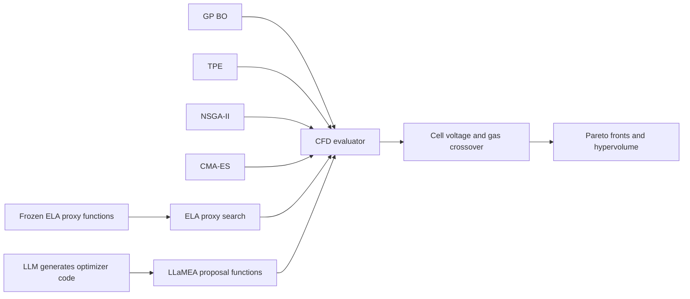

# Algorithm benchmarking

Compare **GP Bayesian optimization, TPE, NSGA-II, multiobjective CMA-ES,
ELA proxy search, and LLaMEA** on the three-variable, two-objective AEMEC problem.
**CFD is the only evaluator.** Models and proxies choose proposals; actual
OpenFOAM responses determine performance.



The two workflows have different purposes and accounting:

| Workflow | Purpose | Budget | Continuation |
| --- | --- | --- | --- |
| [`opt/`](../opt/README.md) | Search for good designs in an optimization study | Completed evaluations; failures are recorded separately | Resume a compatible SQLite/Optuna study |
| `benchmark/` | Compare algorithms under a common experimental protocol | All attempts, including failures and shared initial observations | Fresh output directory per comparison; no exact resume |

## Run

From the repository root, using your activated Python environment:

```bash
python -m pip install -r benchmark/requirements.txt
```

In an environment with OpenFOAM and the compiled AEMEC solver available, run a
small pilot with the four baselines and ELA proxy search using the generated proxy files:

```bash
python benchmark/run_benchmark.py \
  --algorithms gp tpe nsga2 cmaes ela_proxy \
  --proxy-root ELA/results/proxies_verified \
  --budget 8 --initial 4 --seeds 42 \
  --output benchmark/results/aemec_pilot
```

The pilot makes 24 actual design-evaluation attempts: four common initial
designs, then four further designs per algorithm. Each design requires a full
fixed-current run (20 solver-clock units, final 5 averaged by default).
Use `--simulation-duration-s 10` for a shorter run, `--final-window-s` to set
the averaging window, or `--evaluation-mode voltage-sweep` for the original
full sweep. See the [shared evaluation protocol](../opt/docs/fixed-current.md).
`--dry-run` previews the setup without executing CFD or checking
runtime compatibility. The proxy JSON files must be present on the execution
machine. The four baselines remain the default; they do not require ELA files.
Use `--proxy-files` for explicitly located models, or `--proxy-rank` for a
different pair. These options configure only `ela_proxy`.

`cmaes` uses [OptunaHub's MoCmaSampler](https://hub.optuna.org/samplers/mocma/),
bundled at a fixed commit and tested with Optuna 4.9.0. No sampler download is
needed during a run. Its population size is `--initial`; updates happen by
generation. Remove the old `--cma-sigma` option: upstream fixes the initial
step size at `1/6`. The [runbook](docs/runbook.md#how-cma-es-handles-the-two-objectives)
explains the changed behavior and the upstream covariance/selection caveats.

`llamea` is an optional sixth method using the actual LLaMEA 1.4.2 project.
It evolves proposal functions using CFD hypervolume feedback, then deploys the
best candidate within the **same total CFD budget**. It requires Python 3.11+
and `benchmark/requirements-llamea.txt`, plus an explicitly chosen Ollama or
OpenAI model. See the [LLaMEA guide](docs/llamea.md) for installation, commands,
candidate budgets, saved code and provider settings. No LLM requests occur
unless this algorithm is selected and a real run is started.

See the [runbook](docs/runbook.md) for server setup, the full 64-attempt/five-seed
study, algorithm details, metrics, and output files. `--backend aemec` remains
accepted for compatibility, but synthetic evaluation backends are removed.

## Layout

```text
benchmark/
  run_benchmark.py          Command-line entry point
  requirements.txt         Benchmark dependencies
  requirements-llamea.txt  Optional LLaMEA dependencies (Python 3.11+)
  aemec_benchmark/
    cli.py                 Algorithm selection and common CFD settings
    evaluation.py          The sole production evaluator: AEMEC/OpenFOAM
    runner.py              Shared initialization, attempt budgets, reports
    algorithms.py          GP BO, TPE, and NSGA-II
    cmaes.py               OptunaHub sampler loader and protocol metadata
    _vendor/mocma/         Pinned upstream sampler, license, and provenance
    llamea.py              LLaMEA generation, scoring, selection and deployment
    llamea_worker.py       Restricted numerical execution of generated proposals
    proxy_search.py        Direct ELA-proxy proposal algorithm
    proxy_assets.py        Frozen proxy files, validation, and provenance
    metrics.py             Pareto sets, hypervolume, and EHVI
  configs/                 Portable bounds and objective scaling
  docs/                    Benchmark runbook
  tests/                   Algorithm, accounting, and integration tests
  results/                 Generated comparisons (ignored by Git)
  work/                    Isolated CFD scratch cases (ignored by Git)
```

The benchmark reuses `opt/aemec_opt/case.py` and the result/error contract in
`opt/aemec_opt/engine.py`; it does not run the optimization study loop. Keep the
sibling `opt/` directory when copying the project to another machine. The
benchmark launcher resolves these imports automatically. There is one shared
implementation of the physics evaluation, so both workflows measure the same
objectives. The optimization workflow does not depend on the benchmark package.

## Updated paths

The implementation, requirements, configuration, tests, and guide have moved
out of `opt/`. Use `benchmark/run_benchmark.py` and `benchmark/requirements.txt` in
scripts and server commands. New comparisons should write to `benchmark/results/`;
the default scratch directory is `benchmark/work/`.
The old `opt/run_benchmark.py` is only a forwarding launcher.

Existing local `benchmark_cmaes_verified` and `benchmark_proxies_verified`
results were relocated from `opt/results/` to `benchmark/results/`. Their contents
were preserved, including historical paths in manifests; they remain synthetic
proxy benchmark results. Reorganizing the code does not create new CFD results.

The ELA method minimizes randomly weighted proxy trade-offs over a fresh Sobol
candidate pool, then sends the selected design to CFD. Proxies stay frozen;
their scores appear only in proposal diagnostics. Historical CFD data used to
fit them are additional prior information, recorded separately from the common
online CFD budget. The method's actual merit is measured by its CFD results.

## Tests

Run the benchmark suite from the repository root:

```bash
PYTHONPATH=opt:benchmark:. MPLCONFIGDIR=/tmp/aemec-matplotlib \
  python -m unittest discover -s benchmark/tests -v
```

The CFD integration tests mock the expensive evaluator. They verify routing,
budgets, and isolation; actual solver operation must be checked in OpenFOAM.
